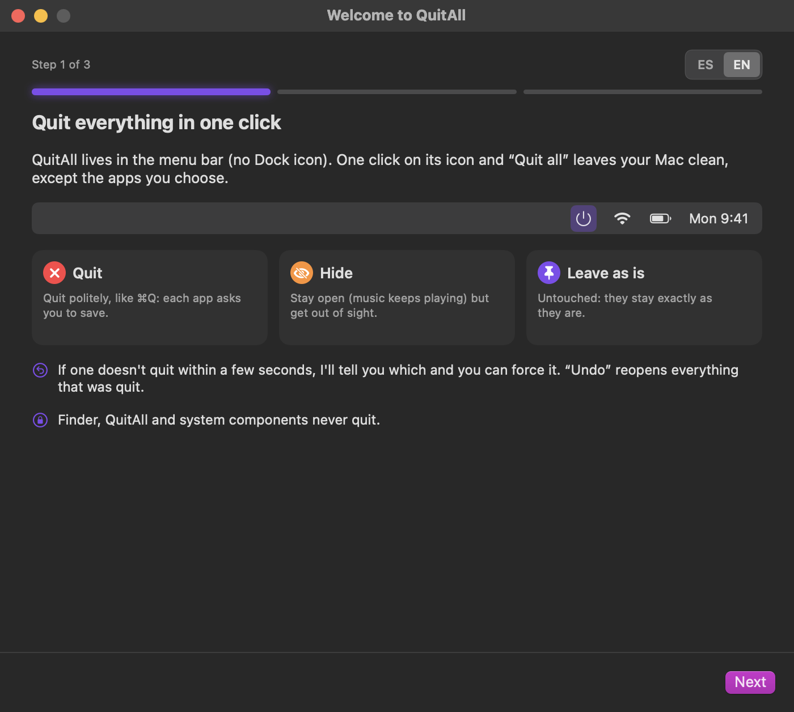
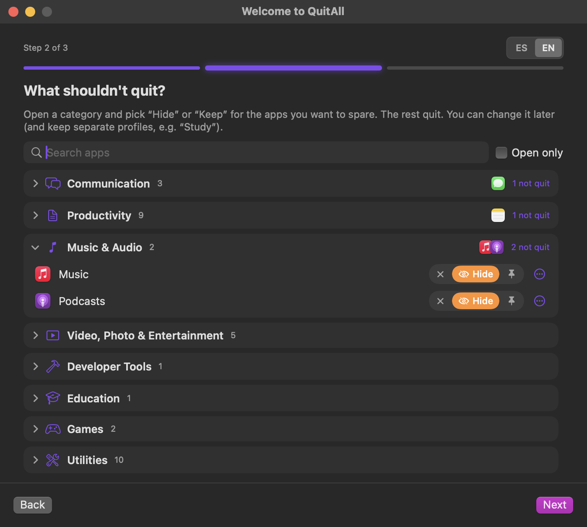
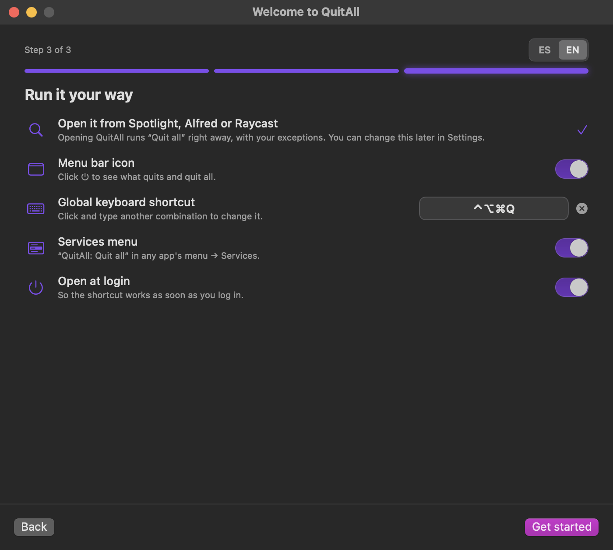
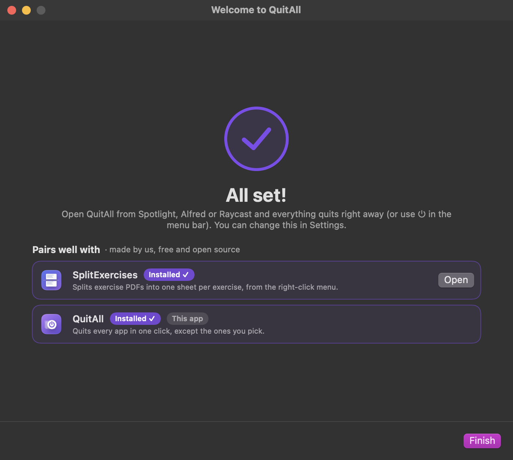
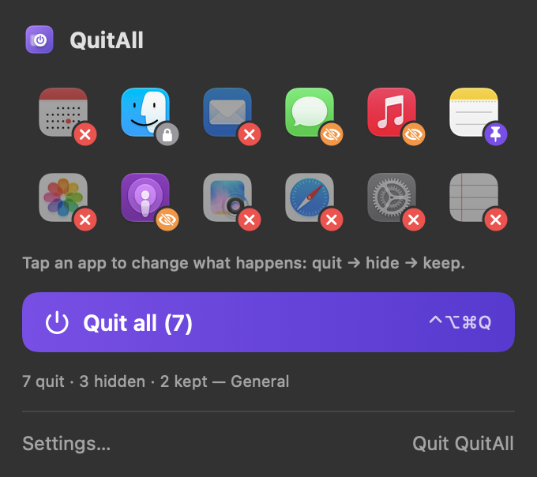
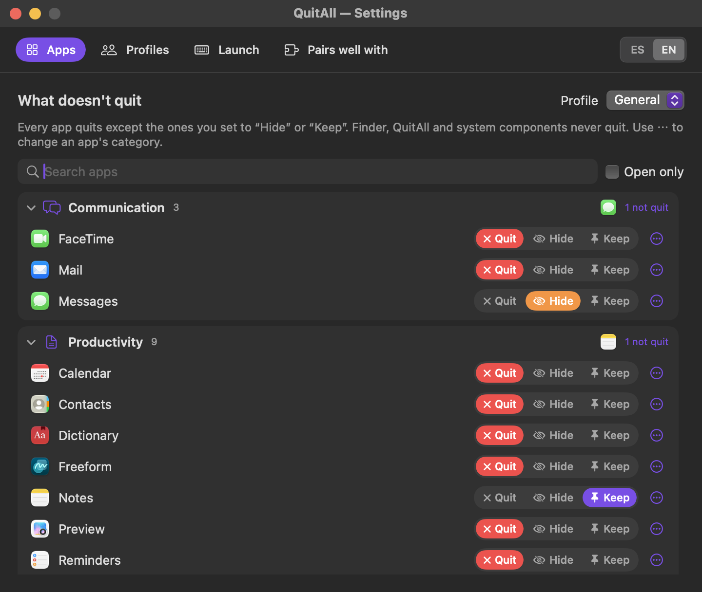
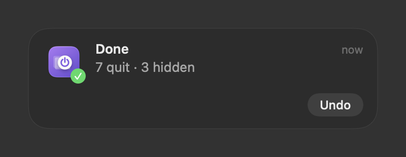
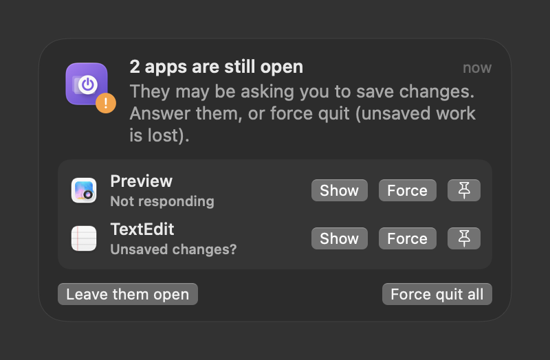

# QuitAll

**Quit every open app in one click — except the ones you pick, which get hidden or left as they are.**

[Español](README.es.md) · macOS 13+ · Apple Silicon & Intel · MIT licence · no network, no accounts

End of the day, switching to study mode, about to share your screen: you want a clean Mac without hunting through the Dock. Open QuitAll from Spotlight, Alfred or Raycast and it's done: **opening the app runs Quit all**. Or use its ⏻ menu bar icon (optional) to see what will happen first.

- **Pick what stays**, in drop-downs by category (Browsers, Communication, Productivity, Music & Audio, Developer Tools, System…), with each app's icon and name. The category comes from the app's own `LSApplicationCategoryType` and you can change it by hand.
- For each app you pick: **Hide** it or **Leave it as is**. Everything else: **Quit**.
- **Polite quitting**: QuitAll asks each app to quit exactly like ⌘Q does, so every app shows its own *save changes?* dialog. After a few seconds (configurable) it tells you which apps are still open — usually because they're waiting for you to save — with **Show**, **Force quit** and **Leave open** for each.
- **Undo**: reopens the apps the last action quit and shows the ones it hid.
- **Safe defaults**: Finder and QuitAll never quit, nor do system components (Dock, Control Center, login window…). Music apps start as *Hide*: they keep playing, just out of sight.
- **Global shortcut** (default ⌃⌥⌘Q, configurable), optional **open at login**, optional **profiles** (e.g. *Study*, *Focus*) with different lists, Spanish/English.

## Install

| Method | Best for | |
|---|---|---|
| **[Installer `.pkg`](https://github.com/jdevesablanco/QuitAll/releases/latest/download/QuitAll.pkg)** | Easiest: double-click, no Terminal | Direct download |
| **[Disk image `.dmg`](https://github.com/jdevesablanco/QuitAll/releases/latest/download/QuitAll.dmg)** | Drag the app to *Applications* | Direct download |
| **Homebrew** | Terminal users | `brew install --cask jdevesablanco/tap/quitall` |
| **Homebrew (from source)** | No Gatekeeper warning | `brew install jdevesablanco/tap/quitall && quitall install` |
| **From source** | Developers | `git clone … && Scripts/build-app.sh` |

Clicking a download link starts the download straight away (latest release). All versions: [Releases](https://github.com/jdevesablanco/QuitAll/releases).
The app is ad-hoc signed, not notarized by Apple, so the first time: *System Settings → Privacy & Security → Open Anyway* (on macOS 13–14, right-click → *Open* also works), or `xattr -dr com.apple.quarantine /Applications/QuitAll.app` (see [docs/NOTARIZATION.md](docs/NOTARIZATION.md)).
Open it once to run the first-run setup.

## First run

Three short steps (ES/EN switch at the top right): what QuitAll does → which apps shouldn't quit (by category) → how you want to launch it (shortcut, Services menu, open at login). The last screen shows the other apps of the pack.

## Screenshots

| 1 · What it does | 2 · What stays open | 3 · How to run it | All set |
|:--:|:--:|:--:|:--:|
|  |  |  |  |

| Menu bar | Choose what quits, hides or stays | Opened from Spotlight / Raycast | An app that won't quit |
|:--:|:--:|:--:|:--:|
|  |  |  |  |

Type “QuitAll” in Spotlight, Alfred or Raycast and press ↩: everything quits and this notice shows what happened, with **Undo**.

## Ways to run “Quit all”

| Where | How |
|---|---|
| Spotlight, Alfred, Raycast | Type “QuitAll” and press ↩: opening the app runs **Quit all** with your exceptions. Hold ⇧ while opening it to get Settings instead. You can change this in *Settings → Launch*. |
| Menu bar | Click ⏻ → **Quit all**. Tap an app's icon there to cycle quit → hide → keep. Right-click ⏻ for a quick menu. |
| Keyboard | Global shortcut, ⌃⌥⌘Q by default (*Settings → Launch*). No Accessibility permission needed. |
| Services menu | Any app's menu → *Services* → **QuitAll: Quit all** (installed from the app). You can give it its own shortcut in *System Settings → Keyboard → Keyboard Shortcuts → Services*. |
| Launchpad, Dock | Just open QuitAll (⌘Space → “QuitAll” → ↩, or pin it to the Dock and click it): opening it **runs Quit all** right away. It never fires at login or right after installing. Prefer the menu instead? *Settings → Launch → When you open QuitAll → Show the menu*. |
| URL | `open quitall://quit`, `open "quitall://quit?profile=Study"`, `open quitall://undo` |
| Shortcuts app | *Open URLs* with `quitall://quit`, or *Run Shell Script* with `quitall quit` |
| Terminal | `quitall quit` (see below) |

## Command line

```bash
quitall plan                       # what would happen to each open app, without touching anything
quitall quit                       # quit politely using the active profile
quitall quit --profile Study --force --timeout 5
quitall undo                       # reopen what the last action quit, show what it hid
quitall rule Spotify keep          # set a rule (quit | hide | keep)
quitall profiles                   # list profiles (* = active)
quitall apps                       # installed apps with category and rule
quitall selftest                   # smoke test, quits nothing
```

The terminal you run `quitall` from is never quit (add `--include-terminal` if you want it to).

## Limitations

- macOS doesn't tell other apps whether a document has unsaved changes. QuitAll can only see that an app is still open after asking it to quit; if it has a window on screen, it's almost always a *save changes?* dialog, so that's what it says.
- **Undo** reopens the apps; which windows and documents come back is up to each app and to *System Settings → Desktop & Dock → Close windows when quitting an application*.
- Only regular apps (the ones with a Dock icon) are quit. Menu bar utilities and background agents are left alone.
- The menu bar icon is optional (*Settings → Launch*). Without it, use QuitAll from Spotlight/Alfred/Raycast, the shortcut or the Dock; hold ⇧ while opening it, or click ⚙︎ in the notice shown after quitting, to reach Settings.
- Profiles are optional: the active one is used by the button, the shortcut and the Service; pick it from the menu bar.

Settings live in `~/Library/Application Support/QuitAll/settings.json`.

## Privacy

Everything runs on your Mac. No telemetry. The only network access is when *you* press **Install** on one of the pack's apps (GitHub's public API / Homebrew).

## Pairs well with

Made by the same author, free and open source:

| App | What it does | Status |
|---|---|---|
| [SplitExercises](https://github.com/jdevesablanco/SplitExercises) | Splits exercise PDFs into one sheet per exercise, from the right-click menu | Available |
| **QuitAll** | Quits every app in one click, except the ones you pick | This app |

The app shows the same cards (in the last setup screen and in *Settings → Pairs well with*), detects which ones you have and installs the rest with Homebrew or the latest `.pkg` from GitHub.

## Development

- `Sources/QuitAllCore`: app catalog and categories, protected apps, polite quit + undo (Apple frameworks only).
- `Sources/QuitAllApp`: SwiftUI/AppKit menu bar app. `PackCatalog.swift` is shared verbatim by every app of the pack.
- `Sources/QuitAllCLI`: the `quitall` command.
- `QUITALL_SNAPSHOT=/dir build/QuitAll.app/Contents/MacOS/QuitAll` renders the setup screens to PNG; `QUITALL_CONFIG_DIR=/dir` isolates settings.

## License

MIT © 2026 Julio Devesa Blanco
